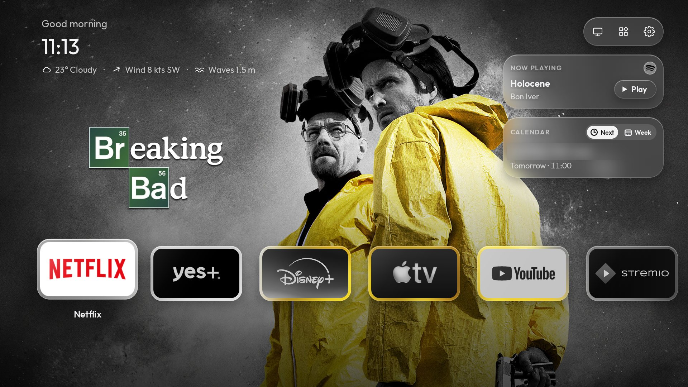
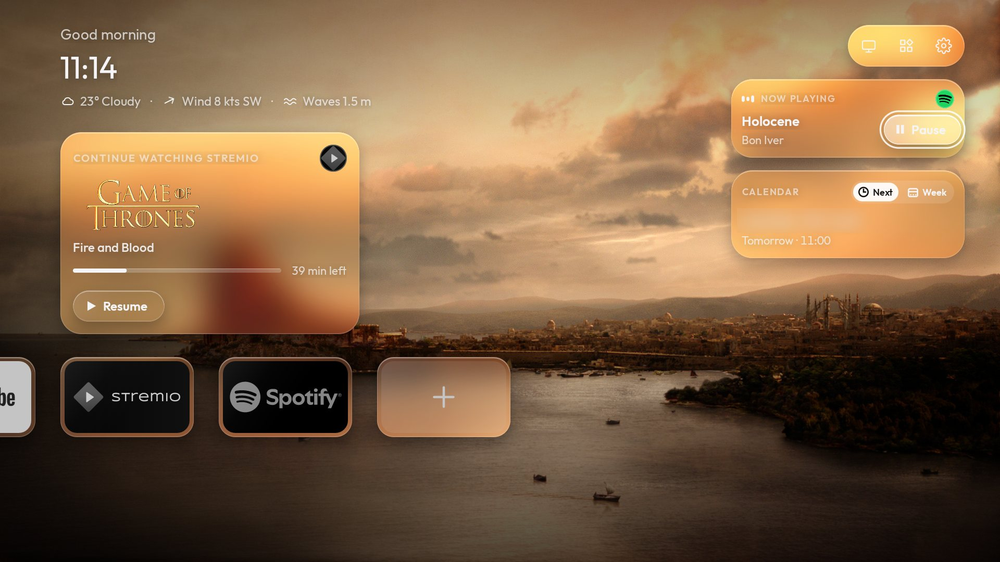
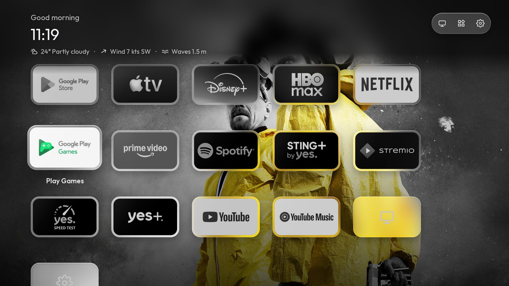
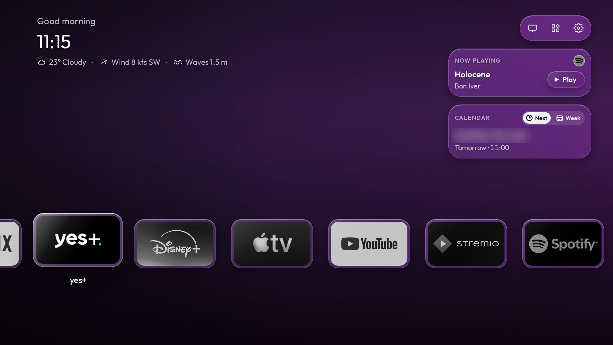

# apple-yes-tv-os

A Liquid Glass, tvOS-style home screen for the **yes streamer box** (the yes
pay-TV operator's Android TV box in Israel), and the notes and tools used to
clean the box up.

## Showcase



| | |
| --- | --- |
|  |  |
| **Continue watching** with Resume, and **Now playing** controlling Spotify from Home | **All Apps**, scrolling under a frosted top bar |
|  | |
| A slowly **flowing colour gradient** for apps without show art | |

## Install

You need the box on the same network as a Mac or Linux computer, the remote,
and about 20 minutes.

**Option 1: with [Claude Code](https://claude.com/claude-code).** Run this one
line on the computer. Claude explains how to set up the TV step by step, asks
for the TV's IP address, and asks before installing anything:

```bash
claude "Clone https://github.com/ShaharIzhar/apple-yes-tv-os and install the Yes Launcher on my TV by following launcher/INSTALL-WITH-CLAUDE.md step by step."
```

**Option 2: by hand.** Follow the steps in [`launcher/README.md`](launcher/README.md).

## What's in here

| Folder | What it is |
| --- | --- |
| `launcher/` | The home screen app (Android, Java). `launcher/tools/install.sh <tv-ip>` builds and installs it. |
| `design/` | The design: `LAUNCHER-DESIGN.md` (the spec) and `liquid-glass-home.dc.html` (the mockup). |
| `docs/prompt.md` | The Claude Code prompt the box was debloated and the launcher built with. |
| `cleanyourtv/` | Submodule: [Gathin23/cleanyourtv](https://github.com/Gathin23/cleanyourtv), general debloat tools for Android TVs. Not needed to install the launcher. |

API keys for the show art (TMDB, fanart.tv) are optional and come from
environment variables at build time, never from a file in the repo. See
"What you need" in `launcher/README.md`.

To also get the debloat tools: `git submodule update --init`.
